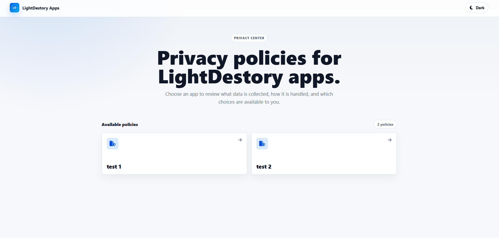

<a name="readme-top"></a>

<br />

<div align="center">

  <a href="https://github.com/LightDestory/MultiPrivacyPolicyViewer">
    
  </a>

  <h2 align="center">Multi Privacy Policy Viewer</h2>
  
  <p align="center">
      Lightweight Express-based viewer that serves Markdown privacy policies as styled HTML pages with SPA navigation, dark mode, and Docker support.
  </p>
  
  <br />
  <br />

</div>

<details>
  <summary>Table of Contents</summary>
  <ol>
    <li>
      <a href="#book-about-the-project">📖 About The Project</a>
    </li>
    <li>
      <a href="#gear-getting-started">⚙️ Getting Started</a>
      <ul>
        <li><a href="#prerequisites">Prerequisites</a></li>
        <li><a href="#installation">Installation</a></li>
        <li><a href="#docker">Docker</a></li>
        <li><a href="#usage">Usage</a></li>
        <li><a href="#api-endpoints">API Endpoints</a></li>
        <li><a href="#notes">Notes</a></li>
      </ul>
    </li>
    <li><a href="#dizzy-contributing">💫 Contributing</a></li>
    <li><a href="#handshake-support">🤝 Support</a></li>
    <li><a href="#warning-license">⚠️ License</a></li>
    <li><a href="#hammer_and_wrench-built-with">🛠️ Built With</a></li>
  </ol>
</details>

## :book: About The Project

**Multi Privacy Policy Viewer** is a Node.js web application that dynamically renders privacy policies from Markdown files. It reads `.md` files from the `policies/` directory and serves them as styled HTML pages through a clean, accessible interface.

Key features:

- **Markdown-driven** — Drop `.md` files in `policies/`; no config changes needed.
- **SPA navigation** — Client-side routing via `history.pushState` with smooth page transitions (no full reloads).
- **Dark/light theme** — Persistent toggle stored in `localStorage`. Default respects system `color-scheme`.
- **Path traversal protection** — Server validates app names against a strict regex and resolves paths to prevent directory escape.
- **No-cache headers** — All API responses disable caching so policies always reflect the latest file content.
- **Docker-ready** — `Dockerfile` + `docker-compose.yml` with volume mount for live policy updates and container health check.

Built with Express 5, EJS (server shell), marked (Markdown → HTML), and vanilla JS (client logic). No database, no build step — just drop files and run.

<p align="right">(<a href="#readme-top">back to top</a>)</p>

## :gear: Getting Started

<p align="right">(<a href="#readme-top">back to top</a>)</p>

### Prerequisites

- **Node.js** 18+ (runtime)
- **npm** (ships with Node.js)
- **Docker** (optional, for containerized deployment)

<p align="right">(<a href="#readme-top">back to top</a>)</p>

### Installation

```bash
# Clone repository
git clone https://github.com/LightDestory/MultiPrivacyPolicyViewer.git
cd MultiPrivacyPolicyViewer

# Install dependencies
npm install

npm start (or equivalent: node server.js)

# Copy your privacy policy markdown files into policies/
# The app is now listening on http://localhost:3000
```

<p align="right">(<a href="#readme-top">back to top</a>)</p>

### Docker

```bash
# Build and start with docker-compose
docker compose up -d

# Policies directory is mounted as a volume — edit .md files without rebuilding
# Health check runs every 30s on /health endpoint
```

Or build manually:

```bash
docker build -t privacy-policy-viewer .
docker run -d -p 3000:3000 -v ./policies:/app/policies privacy-policy-viewer
```

<p align="right">(<a href="#readme-top">back to top</a>)</p>

### Usage

1. Place Markdown files (`.md`) in the `policies/` directory.
2. File names become app identifiers — `my_app.md` → visible as `my app` in the UI.
3. Navigate to `http://localhost:3000` to see the policy list.
4. Click an app card to view its rendered privacy policy.
5. Toggle dark/light theme using the button in the top bar (persists across sessions).

Policy file names use `[-_]+` separators rendered as spaces. Example: `my_cool_app.md` displays as "my cool app".

<p align="right">(<a href="#readme-top">back to top</a>)</p>


### API Endpoints

| Method | Path | Description |
|--------|------|-------------|
| `GET` | `/api/policies` | List all available policy names (`.md` files in `policies/` without extension) |
| `GET` | `/api/policy/:appName` | Get rendered HTML content for a specific policy |
| `GET` | `/health` | Health check — returns `{ "status": "healthy" }` |
| `GET` | `/*` | Catch-all — serves the EJS app shell |

All API responses include no-cache headers to ensure fresh content. Policy names are validated against `^[a-zA-Z0-9_-]+$` with path traversal protection via resolved path prefix check.

<p align="right">(<a href="#readme-top">back to top</a>)</p>

### Notes

- Empty states are handled: no `.md` files → "No privacy policies are available yet." message.
- Error pages for 400 (invalid name), 403 (path traversal), 404 (policy not found), and catch-all network errors are rendered client-side.

<p align="right">(<a href="#readme-top">back to top</a>)</p>

## :dizzy: Contributing

If you are interested in contributing, please refer to [Contributing Guidelines](.github/CONTRIBUTING.md) for more information and take a look at open issues. Ask any questions you may have and you will be provided guidance on how to get started.

Thank you for considering contributing.

<p align="right">(<a href="#readme-top">back to top</a>)</p>

## :handshake: Support

If you find value in my work, please consider making a donation to help me create, and improve my projects.

Your donation will go a long way in helping me continue to create free software that can benefit people around the world.

<p align="center">
<a href='https://ko-fi.com/M4M6KC01A' target='_blank'></a>
</p>

<p align="right">(<a href="#readme-top">back to top</a>)</p>

## :warning: License

The content of this repository is distributed under the GNU GPL-3.0 License. See `LICENSE` for more information.

<p align="right">(<a href="#readme-top">back to top</a>)</p>

## :hammer_and_wrench: Built With

- [Express](https://expressjs.com/) — HTTP server framework (v5)
- [EJS](https://ejs.co/) — Server-side template engine for the HTML shell
- [marked](https://marked.js.org/) — Markdown to HTML converter
- [Font Awesome](https://fontawesome.com/) — Icon set (loaded from CDN)
- [Docker](https://www.docker.com/) — Containerization (node:20-alpine)

<p align="right">(<a href="#readme-top">back to top</a>)</p>
